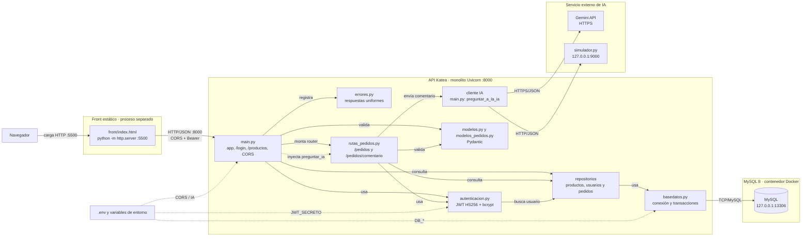

# Katea — API de productos y pedidos

Proyecto académico con FastAPI, Pydantic, MySQL 8 y PyMySQL. Incluye login JSON,
roles y pedidos con control de dueño. QR, pagos y caja quedan para otra etapa.

## Arquitectura y distribución

Katea no es un sistema de microservicios: la API es un **monolito** y sus módulos
Python se ejecutan en el mismo proceso Uvicorn. La distribución está en los
límites de proceso y de red: el front estático, MySQL y el proveedor de IA.



Las flechas continuas entre subgrafos representan tráfico de red. Las flechas
dentro de `API Katea` representan imports y llamadas de función en el mismo
proceso. Las líneas discontinuas son configuración leída al arrancar.

### Qué está distribuido

| Límite | Componentes | Protocolo | Qué viaja |
| --- | --- | --- | --- |
| Navegador ↔ front | Navegador y `http.server` | HTTP :5500 | HTML, CSS y JavaScript |
| Navegador ↔ API | JavaScript del front y API | HTTP/JSON :8000 | Credenciales, JWT, productos y pedidos; CORS |
| API ↔ MySQL | Uvicorn y contenedor MySQL | TCP/MySQL :13306 | SQL parametrizado y resultados; transacciones |
| API ↔ IA | Uvicorn y Gemini o simulador | HTTPS o HTTP :9000 | Comentario y contexto del usuario; sentimiento y respuesta |
| Módulos de la API | Mismo proceso | Imports y llamadas | Modelos, repositorios, excepciones |

El navegador nunca habla directamente con MySQL ni con el servicio de IA: todo
pasa por la API. El front y MySQL son procesos separados; Gemini es un servicio
externo y el simulador ocupa su lugar en las pruebas locales.

### Flujo de una petición

1. El navegador carga `front/index.html` desde `http.server` y su JavaScript
   envía las peticiones a `http://127.0.0.1:8000`.
2. `main.py` aplica CORS, recibe el JSON y lo valida con Pydantic.
3. En rutas protegidas, `autenticacion.py` valida el JWT con `usuario_actual`;
   `exigir_admin` comprueba el rol antes de permitir escrituras.
4. `rutas_pedidos.py` o los endpoints de productos llaman a los repositorios.
5. Los repositorios usan `basedatos.py` para abrir una conexión a MySQL, ejecutar
   SQL parametrizado y confirmar o revertir la transacción.
6. Para `POST /pedidos/comentario`, la ruta usa el cliente inyectado desde
   `main.py`; envía el comentario y el contexto del usuario a Gemini o al
   simulador, valida la respuesta y la devuelve.
7. `errores.py` transforma excepciones y fallos de validación en el formato
   uniforme de error.

`pytest`, `probar_*.py` y `simulador.py` son herramientas de prueba o apoyo: las
pruebas propias usan la app en proceso y dobles de repositorio; los scripts del
profesor actúan como clientes HTTP; el simulador reemplaza a Gemini. No forman
parte del proceso de producción.

Actualmente se ejecuta una sola instancia de la API. El diseño permitiría varias
réplicas contra el mismo MySQL, pero no hay balanceador, caché, colas ni
descubrimiento de servicios configurados. En el runtime, la API es el único
componente que habla con MySQL y con el servicio de IA;
`scripts/crear_usuarios_desarrollo.py` es una herramienta administrativa que
también accede a MySQL, pero no forma parte del servicio.

## Preparación

La guía reproducible para el equipo está en [docs/U3S4.md](docs/U3S4.md): instala
dependencias, configura un MySQL de desarrollo, crea cuentas y ejecuta dos
corridas con la matrícula de cada integrante.

```bash
python3 -m venv .venv
source .venv/bin/activate
python -m pip install -r requirements.txt
python -m pip check
```

Copia la plantilla y completa los valores propios. No versionar `.env` ni
credenciales:

```bash
cp .env.example .env
chmod 600 .env
```

Genera `JWT_SECRETO` sin imprimirlo en la terminal ni en el historial. El
siguiente comando conserva un secreto existente y solo reemplaza un marcador o un
valor demasiado corto:

```bash
python - <<'PY'
from pathlib import Path
from secrets import token_urlsafe
from dotenv import dotenv_values, set_key
ruta = Path('.env')
actual = dotenv_values(ruta).get('JWT_SECRETO') or ''
if len(actual.encode('utf-8')) < 32 or actual.startswith('REEMPLAZAR'):
    set_key(ruta, 'JWT_SECRETO', token_urlsafe(48))
ruta.chmod(0o600)
PY
```

## Variables de entorno

`.env.example` es la plantilla de referencia. La API carga `.env` desde la raíz
del proyecto con python-dotenv; las variables exportadas en la terminal tienen
prioridad sobre el archivo. Reinicia la API después de cambiar cualquier variable.
En particular, `GEMINI_API_KEY`, `GEMINI_MODELO` y `EXTERNO_URL` se leen al
importar `main.py`.

| Variable | ¿Obligatoria? | Valor de ejemplo | Uso |
| --- | --- | --- | --- |
| `DB_HOST` | Sí | `127.0.0.1` | Host de MySQL. |
| `DB_PORT` | Sí | `13306` | Puerto de MySQL; debe coincidir con el publicado por Compose. |
| `DB_USER` | Sí | `katea_app` | Usuario de la aplicación en MySQL. |
| `DB_PASSWORD` | Sí | clave propia | Contraseña de `DB_USER`. No reutilizar claves personales. |
| `DB_NAME` | Sí | `katea` | Base de datos, que debe existir antes de arrancar la API. |
| `MYSQL_ROOT_PASSWORD` | Solo con Compose | otra clave propia | Contraseña de `root` del contenedor MySQL; la API no la lee. |
| `JWT_SECRETO` | Sí, para login y rutas protegidas | secreto aleatorio | Firma los JWT HS256; mínimo 32 bytes y debe conservarse entre reinicios. |
| `CORS_ORIGENES` | No | `http://127.0.0.1:5500,http://localhost:5500` | Orígenes permitidos separados por comas. Ese es el valor por defecto; no se admite `*`. |
| `KATEA_ENTORNO` | No | `desarrollo` | Habilita únicamente `scripts/crear_usuarios_desarrollo.py`; omitir en producción. |
| `GEMINI_API_KEY` | No | clave de Google AI Studio | Necesaria para `POST /pedidos/comentario` contra Gemini; sin ella responde 503. No versionar. |
| `GEMINI_MODELO` | No | `gemini-flash-lite-latest` | Modelo de Gemini usado por el endpoint de comentarios. |
| `EXTERNO_URL` | No | `http://127.0.0.1:9000` | API externa de IA. Por defecto `https://generativelanguage.googleapis.com`; apunta al simulador para las pruebas 21–25. Está comentada en `.env.example`. |

Las variables `DB_*` faltantes o vacías impiden el arranque con un mensaje que
indica cuáles completar. `JWT_SECRETO` se rechaza si es corto o si conserva el
marcador `REEMPLAZAR...`. `.env` está en `.gitignore`: nunca lo subas al
repositorio.

`compose.yaml` ofrece MySQL 8, puerto local 13306, proyecto Docker katea y volumen
katea_mysql_data. Completar también MYSQL_ROOT_PASSWORD antes de iniciarlo:

```bash
docker compose up -d --wait mysql
python scripts/crear_usuarios_desarrollo.py
python -m uvicorn main:app --host 127.0.0.1 --port 8000
```

El comando de cuentas requiere KATEA_ENTORNO=desarrollo y pide claves sin eco
para dev_admin, dev_cliente1 y dev_cliente2. Las inserta juntas con hashes bcrypt;
si alguna existe, revierte sin reemplazar datos. No hay cuentas automáticas.

MySQL crea la base/usuario de Compose solo al inicializar un volumen nuevo;
cambiar `.env` después no modifica claves existentes. No eliminar volúmenes
para cambiar una contraseña. Al arrancar, la API crea tablas ausentes, no la base.
Las conexiones usan commit/rollback/cierre y SQL con `%s` y valores separados.

## Front y CORS

Para servir el front, desde la raíz ejecuta `cd front` y luego
`python -m http.server 5500 --bind 127.0.0.1`; abre
http://127.0.0.1:5500. No abras `index.html` con doble clic: su origen sería
`null`, que la API no permite. Inicia sesión como `dev_admin` (admin), creado con
`KATEA_ENTORNO=desarrollo python scripts/crear_usuarios_desarrollo.py`.

`CORS_ORIGENES` define la lista de orígenes permitidos separados por comas (ver
[Variables de entorno](#variables-de-entorno)). Por defecto es
`http://127.0.0.1:5500,http://localhost:5500`, como indica `main.py`. No se usa `*`.

Para correr las pruebas del profesor con el simulador, usa tres terminales:

```bash
python simulador.py
EXTERNO_URL=http://127.0.0.1:9000 GEMINI_API_KEY=valor_de_prueba python -m uvicorn main:app --host 127.0.0.1 --port 8000
python probar_api.py
```

`simulador.py` y `probar_api.py` son archivos del profesor. `prueba.json` es
configuración local de pruebas y no se sube al repositorio.

## Rutas y permisos

| Operación | Acceso | Éxito |
| --- | --- | --- |
| POST `/login` | Público, credenciales JSON | 200, access_token y token_type |
| GET `/productos` | Público, incluye no disponibles | 200 |
| GET `/productos/{id}` | Público | 200 |
| POST `/productos` | Admin | 201 |
| PUT `/productos/{id}` | Admin, reemplazo completo | 200 |
| DELETE `/productos/{id}` | Admin | 204 sin cuerpo |
| GET `/pedidos` | Cliente: propios; admin: todos | 200 |
| GET `/pedidos/{id}` | Cliente: propio; admin: cualquiera | 200 |
| POST `/pedidos` | Autenticado; dueño desde token | 201 |
| POST `/pedidos/comentario` | Autenticado; usuario desde token | 200, sentimiento y respuesta de IA |
| DELETE `/pedidos/{id}` | Cliente: propio; admin: cualquiera | 204 sin cuerpo |

JWT HS256 con identidad, rol y vencimiento de 30 minutos; contraseñas con bcrypt,
sal aleatoria y costo 12. Token ausente/inválido/vencido: 401 con
WWW-Authenticate Bearer. Cliente que escribe productos: 403. Pedido ajeno o
inexistente: el mismo 404. El token no contiene contraseñas ni hashes.

`POST /pedidos/comentario` exige sesión y recibe `{"comentario": "..."}` (2–300
caracteres, sin campos extra). La API consulta el nombre, ID y rol del usuario
autenticado y los incluye en el contexto enviado a Gemini; nunca acepta esos
datos desde el cuerpo. Configurar `GEMINI_API_KEY` en el entorno (y opcionalmente
`GEMINI_MODELO` o `EXTERNO_URL`) para usar la IA. La llamada reintenta una vez
ante 5xx/429, pero no ante 400, respuestas inválidas ni timeouts. Respuestas
inesperadas de la IA dan 502; falta de configuración, 503; tiempo de espera
agotado, 504.

## Reglas de datos

Productos exige seis campos y rechaza extras, incluido id. Nombre: 2–80 y
descripción: 5–200 caracteres tras recortar extremos. Precio: número positivo,
sin textos/booleanos y máximo dos decimales. Se convierte a Decimal después de
la lectura JSON normal, sin preservar precisión arbitraria previa a validar.
Imagen: sufijo literal .jpg/.jpeg/.png/.webp, nombre no vacío y sin CR/LF; no se
descarga. Disponible: booleano estricto. Preparación: frio/caliente/no_aplica.
Duplicados: nombre normalizado con strip/casefold y preparación; conflicto 409.
PUT excluye al propio producto y puede repetirse sin cambiar el resultado.

Pedidos recibe productos no vacíos con producto_id y cantidad entera positiva;
rechaza dueño, precios, total, estado y otros campos extra. Lee precios y
disponibilidad desde MySQL; guarda precio unitario histórico y total en una
transacción. Un fallo revierte cabecera y detalles. Los importes de pedidos se
devuelven como textos con dos decimales; productos conserva precio numérico.
Lista vacía, cantidad inválida o producto inexistente en el cuerpo: 422.
Producto no disponible: 409. Borrar un producto referenciado por pedidos: 409;
puede desactivarse para nuevas compras. Borrar expresamente un pedido autorizado
elimina sus detalles. Ver [docs/PEDIDOS.md](docs/PEDIDOS.md).

Errores uniformes: `{"error": "...", "detalles": [...]}`. JSON mal formado: 400;
datos inválidos: 422; fallo interno: 500 genérico.

## Contrato y pruebas

Swagger: `/docs`, ReDoc: `/redoc`, esquema: `/openapi.json`. Authorize permite
usar Bearer en las rutas protegidas. Contrato exportado: `docs/openapi.json`.

```bash
PYTHONDONTWRITEBYTECODE=1 python -m pytest -q -p no:cacheprovider
python scripts/generar_contrato.py
python probar_externo.py prueba_U3S4.local.json
```

`probar_externo.py` valida el endpoint configurado en la sección `externo` de
`prueba.json`/`prueba_U3S4.local.json`; reutiliza el login de `auth` si
`externo.token` indica admin, usuario u otro.

La suite propia usa repositorios aislados y un adaptador SQL en memoria, sin
conectar a MySQL real. Resultado previo registrado: 202 aprobadas.
La integración previa con MySQL 8.0.46 aislado comprobó hashes/login, permisos,
propiedad, DECIMAL histórico, FK RESTRICT/CASCADE y rollback ante fallo de detalle.
U3S4 obtuvo 19/20 con persistencia pendiente y 20/20 tras reiniciar solo la API.
No son resultados de una nueva ejecución personal de cada integrante.
Faltan pruebas de concurrencia y carga.

`probar_api_U3S4.py` es la copia auténtica de las 20 pruebas, sin cambios y sin
sobrescribir probar_api.py/probar_api_U3S3.py anteriores. Usar una copia personal
ignorada de `prueba_U3S4.example.json`; instrucciones completas de cuentas,
producto soporte, matrícula, reinicio y respaldo por ronda en
[docs/U3S4.md](docs/U3S4.md). Los scripts U3S3 no hacen login y sus resultados
anteriores son históricos; no validan las escrituras protegidas actuales.

Configuración personal, reportes, capturas, evidencias y estado temporal quedan
fuera de Git. Conservar los cambios personales de prueba.json sin incluirlos en
commits. El contexto del equipo está en [docs/CONTEXTO_PROYECTO.md](docs/CONTEXTO_PROYECTO.md).

El catálogo de errores está en [docs/errores.md](docs/errores.md) y las decisiones
de arquitectura en [docs/decisiones/](docs/decisiones/).
