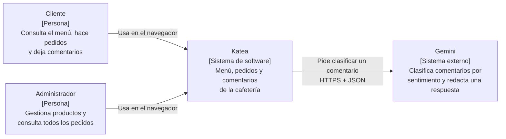
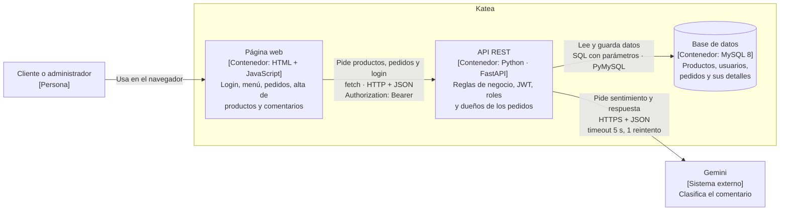
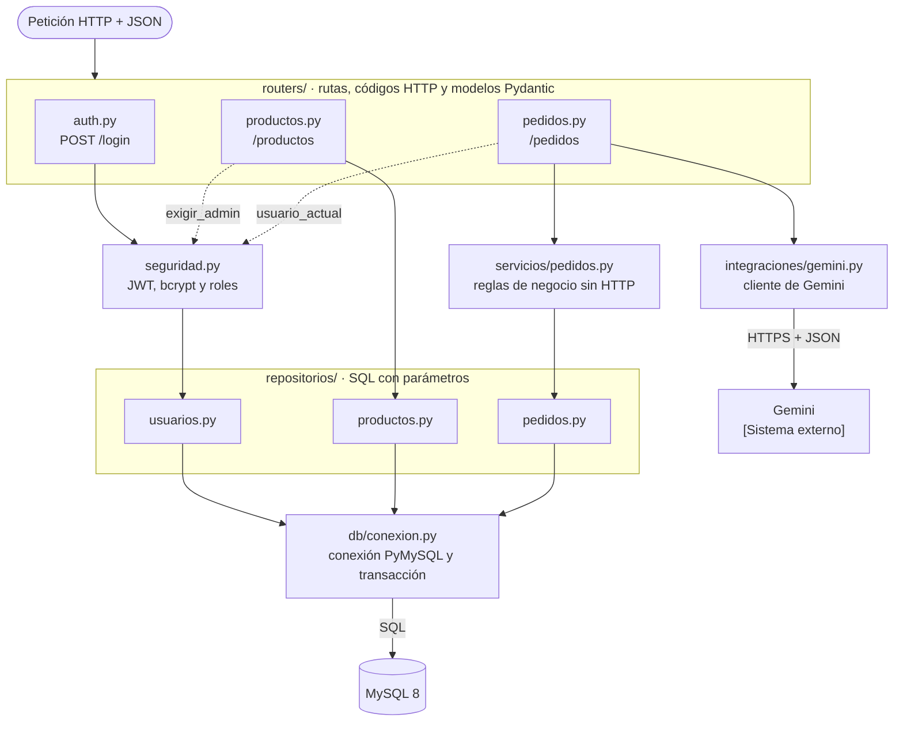

# Arquitectura

Se describe con el modelo C4 (Simon Brown), del nivel más general al más detallado.
Cada caja dice nombre, [tipo y tecnología] y para qué sirve; cada flecha dice qué se
pide y por qué medio.

## Nivel 1 · Contexto: quién usa el sistema y con qué otros sistemas habla

## Nivel 2 · Contenedores: las piezas que se ejecutan por separado

Cada flecha de este diagrama es un mensaje por la red: aquí se ve lo distribuido del proyecto.

### Dónde corre cada pieza en desarrollo

| Pieza | Dirección | Dónde se configura |
|---|---|---|
| Página web | `http://127.0.0.1:5500` (`python -m http.server 5500`) | `front/index.html` (`CONFIG.api`) |
| API REST | `http://127.0.0.1:8000` (`uvicorn app.main:app --port 8000`) | `README.md` |
| MySQL 8 | `127.0.0.1:13306` en el equipo → `3306` dentro del contenedor | `compose.yaml`, `DB_PORT` |
| Gemini | `https://generativelanguage.googleapis.com` | `EXTERNO_URL`, `GEMINI_MODELO`, `GEMINI_API_KEY` |

Detalles de las flechas, tomados del código:

- **Página → API:** el navegador solo acepta respuestas para los orígenes de `CORS_ORIGENES`
  (por omisión `http://127.0.0.1:5500` y `http://localhost:5500`); nunca se usa `"*"`.
  El token viaja en la cabecera `Authorization: Bearer` de cada petición protegida.
- **API → MySQL:** se abre una conexión por operación con `connect_timeout=5` y las consultas
  llevan parámetros (`%s`), nunca texto del usuario pegado al SQL.
- **API → Gemini:** cada intento espera como máximo 5 s (`EXTERNO_TIMEOUT`; si falta, no es
  número o no es positivo, se usan 5). Hay **un solo reintento**, y solo ante 429, 5xx o fallo
  de conexión; un timeout no se reintenta para no duplicar la espera. Lo implementa
  `app/integraciones/gemini.py`.

## Qué pasa si algo falla

| Si falla... | Qué responde la API | Por qué |
|---|---|---|
| Gemini tarda más de 5 s en contestar | **504** | La API no se queda esperando: corta el intento, avisa en segundos y la página muestra el mensaje. |
| Gemini responde un error (4xx, o 429/5xx otra vez tras el reintento), no se puede conectar, o contesta algo que no es el JSON `{sentimiento, respuesta}` esperado | **502** | El problema es del otro servicio, no de la petición del usuario. |
| Falta `GEMINI_API_KEY` | **503** | El servicio no está configurado. Solo afecta a `POST /pedidos/comentario`; el resto de la API sigue funcionando. |
| La página viene de un origen que no está en `CORS_ORIGENES` | El navegador bloquea la respuesta | CORS impide que una página ajena use la API con la sesión del usuario. |
| La base de datos está caída o no responde en 5 s | **500** `{"error": "Error interno del servidor", "detalles": []}` | El manejador genérico de `app/errores.py` registra la traza en el servidor y nunca la envía al cliente. Si MySQL está caída al arrancar, la API no inicia, porque crea sus tablas en el arranque. |

Todas las respuestas de error usan el mismo formato `{"error": ..., "detalles": [...]}`.

## Capas internas de la API

Este diagrama no es C4 formal: muestra cómo se organiza `app/` por dentro. Cada capa solo
llama a la de abajo. Productos y autenticación no tienen reglas que merezcan un servicio
propio, así que sus routers usan el repositorio directamente; pedidos sí pasa por
`servicios/pedidos.py`.

### Recorrido de una petición: `POST /pedidos/comentario`

1. La página envía el comentario con `fetch` y la cabecera `Authorization: Bearer`.
2. Si el origen no está permitido, el navegador bloquea la respuesta (CORS).
3. `usuario_actual` (en `seguridad.py`) verifica el JWT; si falta o venció → 401. Se revisa
   antes que el cuerpo: sin sesión, la API no dice nada sobre los datos enviados.
4. FastAPI valida el cuerpo con Pydantic: JSON roto → 400; comentario vacío o fuera de
   2–300 caracteres → 422.
5. El router arma la instrucción con los datos del cliente y llama a `preguntar_a_la_ia`
   en `integraciones/gemini.py`, que aplica el timeout, el reintento y los códigos 502/503/504.
6. `validar_respuesta_ia` (en `servicios/pedidos.py`) acepta solo un sentimiento conocido
   (`positivo`, `neutral`, `negativo`) y una respuesta no vacía; si no → 502.
7. La API responde 200 con `{"sentimiento", "respuesta"}`.
